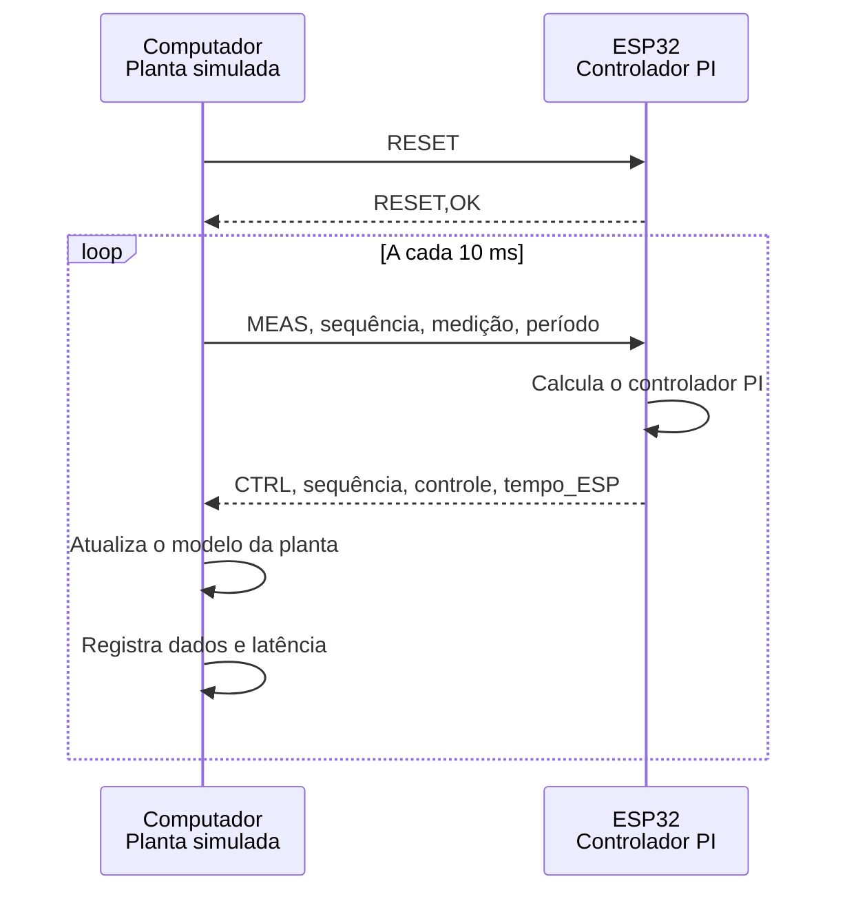

# Relatório detalhado do primeiro ensaio HIL físico com ESP32

**Data do ensaio:** 21/10/2026

**Placa:** ESP32 DevKit V1 de 30 pinos

**Chip identificado:** ESP32-D0WD-V3, revisão 3.0

**Interface USB:** CH9102

**Porta usada no ensaio:** COM5

**Taxa serial:** 921.600 bit/s

## 1. Objetivo

O objetivo deste ensaio foi verificar o fluxo básico de uma simulação *Hardware-in-the-Loop* (HIL) na qual o computador executa o modelo matemático de uma planta e o ESP32 executa um controlador PI. O experimento também teve como objetivos validar a comunicação serial bidirecional, registrar a resposta do sistema e caracterizar a latência observada.

O ESP32 é uma plataforma temporária para aprendizado e validação do conceito. Ele utiliza arquitetura Xtensa e não representa o microcontrolador ARM de 32 bits previsto para a plataforma DAQ final do TCC.

## 2. O que caracteriza este ensaio como HIL

No experimento, a planta não existe como circuito ou equipamento físico. Ela é simulada numericamente no computador. O controlador, por outro lado, é executado em um microcontrolador real. Assim, uma parte do sistema está no ambiente computacional e outra parte está em hardware.



O fluxo validado foi:

1. o computador envia ao ESP32 o valor atual da saída da planta;
2. o ESP32 calcula o sinal de controle;
3. o computador recebe o controle e atualiza a planta;
4. os tempos e valores do ciclo são registrados;
5. o procedimento se repete até o fim do ensaio.

## 3. Preparação do ambiente

O ambiente foi preparado no Windows com:

- Python em ambiente virtual;
- NumPy, SciPy, Matplotlib e pySerial;
- Visual Studio Code;
- extensão PlatformIO IDE;
- PlatformIO Core 6.2.0;
- plataforma Espressif 32 8.0.0;
- framework Arduino para ESP32.

O PlatformIO utilizou a configuração `esp32doit-devkit-v1`, definida em [`../platformio.ini`](../platformio.ini).

## 4. Identificação e gravação da placa

Durante a detecção das portas seriais, COM3 e COM4 foram identificadas como interfaces Bluetooth. O ESP32 conectado pelo conversor USB CH9102 foi encontrado em COM5.

O processo de gravação identificou as seguintes características:

| Característica | Resultado |
|---|---|
| Placa configurada | DOIT ESP32 DevKit V1 |
| Chip | ESP32-D0WD-V3 |
| Revisão | 3.0 |
| Frequência máxima informada | 240 MHz |
| Flash | 4 MB |
| Interface USB | CH9102 |
| Porta utilizada | COM5 |

O firmware foi compilado, gravado e verificado pelo PlatformIO. A compilação final utilizou:

- 22.132 bytes de RAM, aproximadamente 6,8% da memória disponível;
- 307.796 bytes da partição de programa, aproximadamente 23,5% do espaço disponível.

O firmware permanece na memória flash depois que a placa é desconectada. Não é necessário manter o ESP32 conectado para consultar os resultados. A conexão só é necessária para repetir o ensaio, monitorar a porta serial ou gravar uma nova versão do firmware.

## 5. Divisão das tarefas

### 5.1 Computador

O programa [`../hil_pc.py`](../hil_pc.py) é responsável por:

- executar o modelo matemático da planta;
- enviar as medições ao ESP32;
- receber o sinal de controle;
- verificar o número de sequência;
- medir a latência da troca serial;
- controlar o período do ensaio;
- registrar o tempo nominal e o tempo real;
- indicar ciclos em que o prazo foi ultrapassado;
- gerar o arquivo CSV e o gráfico final.

### 5.2 ESP32

O firmware [`../src/main.cpp`](../src/main.cpp) é responsável por:

- receber a medição e o período do ciclo;
- executar o controlador PI;
- limitar o comando entre 0 e 3,3;
- retornar o sinal de controle;
- informar o relógio interno obtido com `micros()`;
- responder aos comandos de diagnóstico e reinicialização.

## 6. Modelo da planta

A planta simulada no computador é um sistema de primeira ordem:

$$
\frac{dy}{dt}=\frac{-y+u}{0,1}
$$

Nessa expressão:

- $y$ é a saída simulada da planta;
- $u$ é o sinal de controle calculado pelo ESP32;
- $0,1$ s é a constante de tempo da planta.

A integração numérica utiliza o método de Euler:

$$
y_{k+1}=y_k+\Delta t\frac{-y_k+u_k}{0,1}
$$

No ensaio final, foi adotado $\Delta t=10$ ms.

## 7. Controlador executado no ESP32

O ESP32 executa um controlador proporcional-integral:

$$
e_k=r-y_k
$$

$$
I_k=I_{k-1}+K_i\Delta t e_k
$$

$$
u_k=K_p e_k+I_k
$$

Os parâmetros utilizados foram:

| Parâmetro | Valor |
|---|---:|
| Referência $r$ | 1,0 |
| Ganho proporcional $K_p$ | 1,2 |
| Ganho integral $K_i$ | 8,0 |
| Limite inferior do controle | 0,0 |
| Limite superior do controle | 3,3 |

O valor entre 0 e 3,3 ainda é apenas numérico. Nenhuma saída analógica ou PWM foi conectada a um circuito externo neste primeiro ensaio.

## 8. Protocolo de comunicação

### 8.1 Reinicialização

Antes de iniciar, o computador envia:

```text
RESET
```

O ESP32 zera o termo integral e responde:

```text
RESET,OK
```

Esse procedimento garante que ensaios consecutivos comecem no mesmo estado e não reutilizem a integral acumulada anteriormente.

### 8.2 Mensagem de medição

Durante o ensaio, o computador envia:

```text
MEAS,<sequência>,<medição>,<período_s>
```

Exemplo:

```text
MEAS,25,0.8453210,0.0100000
```

### 8.3 Resposta do controlador

O ESP32 responde:

```text
CTRL,<sequência>,<controle>,<tempo_us>
```

Exemplo:

```text
CTRL,25,1.057834,3265412
```

O número de sequência permite detectar respostas ausentes, atrasadas ou fora de ordem. O campo `tempo_us` contém o relógio interno do ESP32 no instante da resposta.

## 9. Correção do período de integração

A versão inicial do firmware utilizava internamente um período fixo de 1 ms. Ao testar períodos diferentes no computador, foi identificado que planta e controlador poderiam integrar suas equações com passos distintos.

O protocolo foi corrigido para transmitir o período em cada mensagem. O ESP32 passou a calcular a integral com:

```cpp
integral += KI * sampleTimeS * error;
```

Assim, o controlador e a planta utilizam o mesmo passo de integração. Apenas o ensaio final realizado depois dessa correção é considerado resultado de validação do comportamento dinâmico.

## 10. Testes exploratórios de período

### 10.1 Período de 1 ms

O teste exploratório de 1 ms apresentou latência média de aproximadamente 2,32 ms e máxima de aproximadamente 3,58 ms. Todos os ciclos tiveram latência superior ao período solicitado. Portanto, 1 ms não é viável nesta combinação de Windows, Python, USB serial e firmware.

### 10.2 Período de 5 ms

O teste exploratório de 5 ms apresentou latência média próxima de 3,02 ms e máxima próxima de 5,93 ms. Dois ciclos entre 2000 ultrapassaram o período, indicando margem reduzida.

Esses testes foram usados para selecionar o período do ensaio final. Como foram executados durante o diagnóstico anterior à correção do passo do controlador, seus valores servem somente para caracterizar a comunicação, e não a resposta dinâmica da planta.

### 10.3 Período selecionado

Foi adotado um período de 10 ms, correspondente a uma frequência de atualização de 100 Hz:

$$
f=\frac{1}{0,010}=100\text{ Hz}
$$

Esse valor oferece margem em relação à latência observada e é suficiente para o modelo didático utilizado.

## 11. Configuração do ensaio final

- período: 10 ms;
- quantidade de ciclos: 1000;
- duração nominal: 10 s;
- referência: 1,0;
- comunicação serial: 921.600 bit/s;
- controlador reiniciado antes do primeiro ciclo;
- planta executada no computador;
- controlador executado no ESP32.

## 12. Resultados

| Métrica | Resultado |
|---|---:|
| Amostras concluídas | 1000 |
| Duração nominal | 10 s |
| Duração real | 10,0009 s |
| Latência média | 3,5510 ms |
| Latência mediana | 3,6005 ms |
| Percentil 95 da latência | 4,1618 ms |
| Percentil 99 da latência | 4,3900 ms |
| Latência máxima | 4,8782 ms |
| Violações do prazo de 10 ms | 0 |
| Respostas ausentes, inválidas ou fora de sequência | 0 detectadas |
| Tempo nominal para atingir 90% da referência | 310 ms |
| Valor final da saída | 1,000000 |
| Valor máximo da saída | 1,000000 |


Os dados completos estão disponíveis em [`ensaio_serial_10ms.csv`](ensaio_serial_10ms.csv).

## 13. Interpretação dos resultados

O protótipo executou o ciclo HIL completo. As 1000 mensagens foram respondidas com a sequência esperada e a latência permaneceu abaixo do período de 10 ms. A duração real ficou próxima da duração nominal, com diferença inferior a 1 ms no total registrado.

A resposta da planta foi estável, atingiu 90% da referência em 310 ms de tempo nominal e convergiu para 1,000000. Não foi observado sobressinal no modelo ensaiado.

O resultado demonstra que o ambiente preparado é adequado para experimentos HIL introdutórios a 100 Hz. Ele também estabelece uma base para a evolução do protocolo e para a futura substituição do ESP32 pelo microcontrolador ARM da plataforma final.

## 14. O que a latência representa

A latência foi medida no computador desde o início do envio da mensagem até o recebimento e interpretação da resposta:

```text
PC → driver USB → conversor USB-serial → ESP32 → cálculo PI
   → conversor USB-serial → driver USB → PC
```

Portanto, o valor medido não representa somente o tempo de execução do controlador. Ele inclui Python, agendamento do Windows, buffers, driver USB, transmissão serial, processamento no ESP32 e recepção da resposta.

## 15. O que foi validado

O ensaio confirmou:

- compilação e gravação do firmware pelo PlatformIO;
- funcionamento da interface USB da placa;
- comunicação serial bidirecional;
- comando de reinicialização do controlador;
- protocolo com número de sequência;
- envio do período de amostragem;
- execução do controlador PI no ESP32;
- execução da planta no computador;
- registro de tempo nominal e real;
- medição da latência por ciclo;
- geração automática de CSV e gráfico;
- operação estável a 100 Hz durante 10 segundos.

## 16. Limitações

Este ensaio ainda não valida:

- entradas ou saídas analógicas físicas;
- aquisição de sensores reais;
- controle de um atuador ou circuito externo;
- precisão, ruído ou repetibilidade de medições;
- condicionamento e proteção elétrica;
- isolamento galvânico;
- funcionamento sob carga elevada do computador;
- estabilidade em ensaios de longa duração;
- comportamento de tempo real rígido;
- latência de pior caso;
- desempenho da futura plataforma ARM.

O Windows e a comunicação USB serial não oferecem garantia de tempo real determinístico. Os números obtidos caracterizam apenas o computador, a placa, o cabo, o driver e o software utilizados neste ensaio.

## 17. Como repetir o ensaio

Com o ESP32 conectado, abra o PowerShell na pasta `HIL\esp32_hil_base` e execute:

```powershell
..\ambiente_python\Scripts\python.exe hil_pc.py --modo serial --porta COM5 --passos 1000 --periodo-ms 10
```

A porta COM pode mudar depois de reconectar a placa. Nesse caso, ela deve ser identificada novamente antes da execução.

Para testar somente o programa do computador, sem conectar o ESP32:

```powershell
..\ambiente_python\Scripts\python.exe hil_pc.py --modo simulado --passos 1000 --periodo-ms 10
```

Os arquivos `ensaio.csv` e `ensaio.png` são atualizados a cada nova execução.

## 18. Próximos ensaios recomendados

1. aumentar a duração para avaliar estabilidade e perdas em longo prazo;
2. repetir o teste várias vezes para avaliar repetibilidade;
3. introduzir mudanças de referência e perturbações na planta;
4. registrar e calcular o jitter do período real;
5. testar o comportamento sob diferentes cargas do computador;
6. implementar um protocolo binário com verificação de integridade;
7. conectar entradas e saídas físicas em uma etapa posterior;
8. repetir a metodologia na plataforma ARM selecionada para o TCC.

## 19. Arquivos relacionados

- [`../hil_pc.py`](../hil_pc.py): modelo da planta e comunicação no computador;
- [`../src/main.cpp`](../src/main.cpp): controlador PI executado no ESP32;
- [`../platformio.ini`](../platformio.ini): configuração do PlatformIO;
- [`../README.md`](../README.md): instruções resumidas do experimento;
- [`ensaio_serial_10ms.csv`](ensaio_serial_10ms.csv): dados completos do ensaio;
- [`ensaio_serial_10ms.png`](ensaio_serial_10ms.png): gráfico da resposta e da latência.
