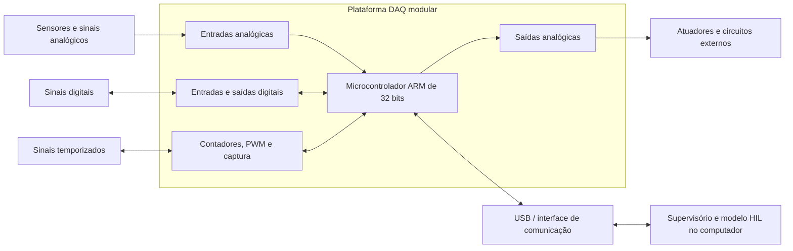
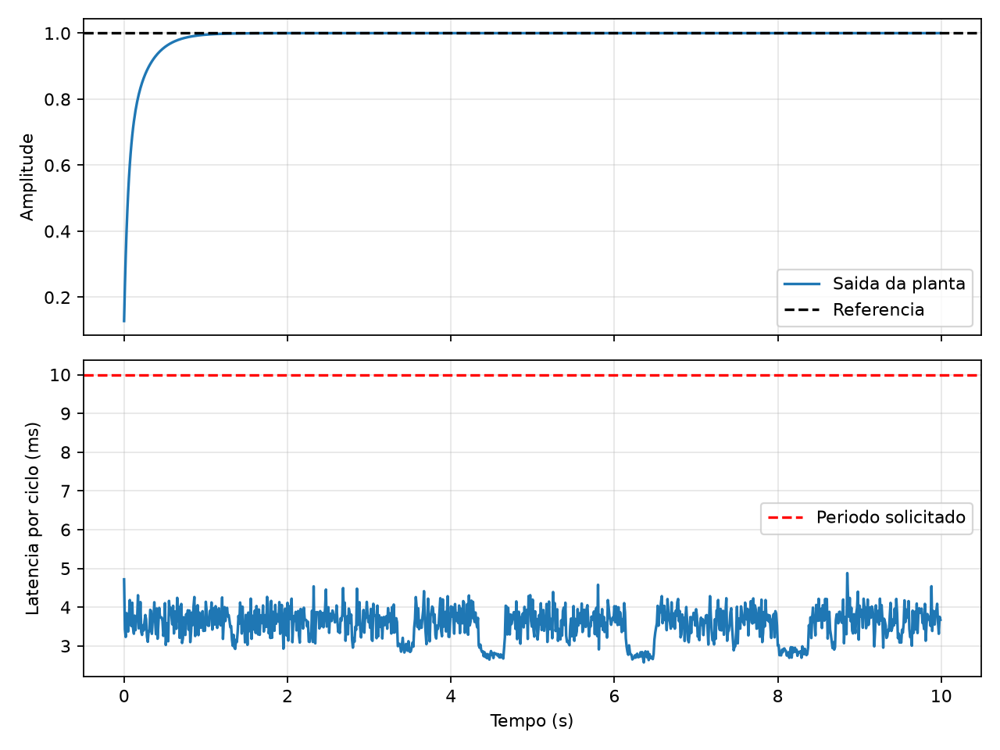

<div align="center">

# 📊 Plataforma modular de aquisição de dados e HIL

### Sistema DAQ de baixo custo, aberto e baseado em microcontrolador ARM de 32 bits


</div>

## 📌 Sobre o projeto

Este repositório reúne o desenvolvimento de um Trabalho de Conclusão de Curso voltado à criação de uma **plataforma eletrônica modular de aquisição de dados (DAQ)**. A proposta é utilizar um microcontrolador ARM de 32 bits para adquirir, processar e transmitir sinais, além de permitir aplicações introdutórias de **Hardware-in-the-Loop (HIL)**.

O projeto busca oferecer uma alternativa **de baixo custo, aberta e adaptável** para atividades de ensino, pesquisa e desenvolvimento em instrumentação eletrônica e sistemas embarcados.

## 🎯 Objetivo geral

Desenvolver uma plataforma eletrônica baseada em microcontrolador ARM de 32 bits capaz de operar como sistema de aquisição de dados e de ser utilizada em aplicações introdutórias de HIL.

## 🧩 Princípios do projeto

- **Modularidade:** possibilidade de adaptar entradas, saídas e interfaces às necessidades de cada aplicação.
- **Código e hardware abertos:** documentação suficiente para estudo, reprodução e evolução da plataforma.
- **Baixo custo:** seleção de componentes e ferramentas acessíveis sem perder de vista a qualidade das medições.
- **Integração com o computador:** comunicação com software supervisório para configuração, visualização e registro de dados.
- **Aplicação didática:** arquitetura compreensível e adequada a experimentos de DAQ, controle e HIL.

## 🏗️ Arquitetura prevista



Essa arquitetura ainda será detalhada durante a definição dos requisitos e a seleção do microcontrolador e dos circuitos de condicionamento de sinais.

## ✅ Estado atual

| Etapa | Situação |
|---|---|
| Revisão bibliográfica sobre DAQ, plataformas abertas e HIL | ✅ Concluída e revisada |
| Estudo de equipamentos comerciais da National Instruments | ✅ Concluído para fundamentação e comparação |
| Levantamento preliminar de requisitos funcionais | 🟡 Em desenvolvimento |
| Preparação do ambiente de simulação HIL no computador | ✅ Concluída |
| Teste HIL inicial com ESP32 DevKit V1 | ✅ Ensaio físico concluído com período de 10 ms |
| Definição da arquitetura final e seleção do ARM | ⏳ Próxima etapa |
| Esquemático, placa de circuito impresso e protótipo | ⏳ Pendente |
| Firmware e software supervisório finais | ⏳ Pendente |
| Ensaios de validação DAQ e demonstração HIL | ⏳ Pendente |

> **Observação sobre o ESP32:** ele está sendo usado como plataforma temporária para aprender e validar a comunicação e o fluxo de um ensaio HIL. O firmware-base foi gravado e testado fisicamente em 21/10/2026. A plataforma final prevista no TCC utilizará um microcontrolador ARM de 32 bits.

## 📁 Organização do repositório

```text
TCC_DAQ/
├── Artigo_Referencia/        # Artigos acadêmicos sobre DAQ, HIL e soluções abertas
├── Documentos da NI/         # Manuais, traduções e estudos de equipamentos da NI
├── HIL/                      # Ambiente Python e primeiro experimento HIL com ESP32
├── Material de Estudo/       # Planos, requisitos preliminares e materiais auxiliares
├── Revisao Bibliografica/    # Versões revisadas do texto e arquivos do Overleaf
└── README.md
```

## 📚 Documentos em destaque

- [Revisão bibliográfica revisada](<Revisao Bibliografica/Revisao_2026-10-20/Revisao_Bibliografica_NI.pdf>)
- [Requisitos funcionais preliminares](<Material de Estudo/Requisitos_Funcionais_Plataforma_DAQ_HIL.pdf>)
- [Estudo do NI CompactDAQ](<Documentos da NI/CompactDAQ/Estudo_CompactDAQ_PT_BR.md>)
- [Resumo técnico do NI USB-6001](<Documentos da NI/NI_USB_6001_Resumo_TCC.md>)
- [Notas de leitura sobre tecnologias da NI](<Documentos da NI/Notas_de_leitura_NI_2026-10-19.md>)
- [Documentação do ambiente HIL](<HIL/LEIA-ME.md>)
- [Experimento HIL inicial com ESP32](<HIL/esp32_hil_base/README.md>)
- [Relatório do primeiro ensaio HIL físico](<HIL/esp32_hil_base/resultados/Relatorio_ensaio_HIL_ESP32_2026-10-21.md>)

## 🧪 Primeiro experimento HIL

O ambiente inicial executa no computador o modelo de uma planta de primeira ordem e reserva ao ESP32 a execução de um controlador PI. A troca de dados é feita por USB serial, permitindo medir resposta, latência, jitter e eventuais perdas de comunicação.

O teste do lado do computador pode ser executado sem conectar a placa:

```powershell
cd HIL\esp32_hil_base
..\ambiente_python\Scripts\python.exe hil_pc.py --modo simulado
```

Para conferir as dependências instaladas:

```powershell
HIL\ambiente_python\Scripts\python.exe HIL\verificar_ambiente.py
```

O projeto do firmware usa **VS Code + PlatformIO** e a configuração `esp32doit-devkit-v1`. No primeiro ensaio físico, 1000 ciclos foram executados com período de 10 ms, sem violações de prazo ou falhas de sequência. A latência média foi de 3,55 ms e a máxima de 4,88 ms.



## 🗺️ Próximas etapas

1. Consolidar requisitos de entradas e saídas, faixas de tensão, resolução, taxa de amostragem, temporização e comunicação.
2. Definir a arquitetura modular e selecionar o microcontrolador ARM de 32 bits.
3. Projetar o condicionamento de sinais, as proteções elétricas e a alimentação.
4. Desenvolver o esquemático e a placa de circuito impresso.
5. Implementar o firmware e o protocolo de comunicação.
6. Desenvolver o software supervisório em Python e/ou LabVIEW.
7. Realizar ensaios de precisão, repetibilidade, ruído, taxa de aquisição e latência.
8. Demonstrar a integração entre um modelo computacional e o hardware real em uma aplicação HIL.

## 🔎 Referência comercial

Os equipamentos da **National Instruments**, especialmente o NI USB-6001 e a família CompactDAQ, foram estudados como referências de arquitetura, desempenho e experiência de uso. Recursos como ganho programável, isolamento, calibração, modularidade e abstração da comunicação ajudam a estabelecer critérios para a plataforma proposta, respeitando o foco em baixo custo e abertura do projeto.

## 👨‍🎓 Contexto acadêmico

Projeto desenvolvido por **Pedro A. Monteiro** como Trabalho de Conclusão de Curso na **Universidade Estadual de Londrina (UEL)**.

O repositório acompanha a evolução da pesquisa, do hardware e do software. A licença aberta aplicável aos arquivos será definida antes da publicação da versão final da plataforma.

