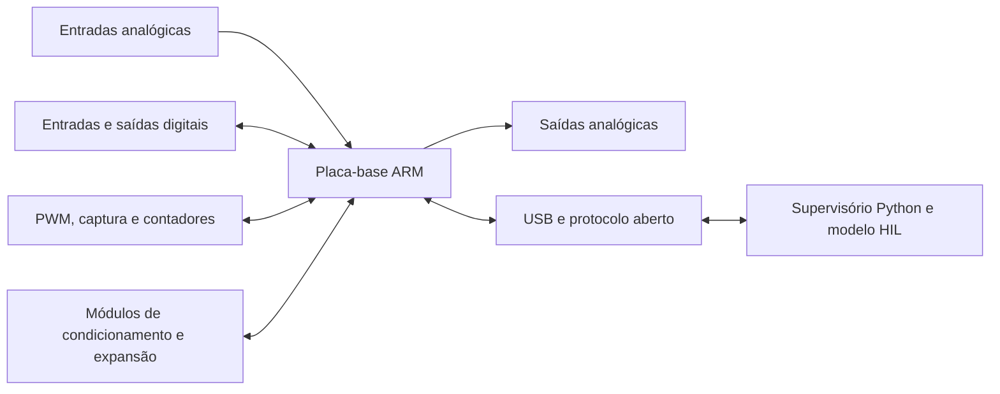

# Especificação de requisitos da plataforma DAQ/HIL

**Projeto:** Plataforma modular, aberta e de baixo custo para aquisição de dados e aplicações introdutórias de HIL  
**Versão:** 0.2 - minuta para validação  
**Data:** 22/10/2026  
**Responsável:** Pedro de Avance Monteiro  
**Orientador:** Prof. Dr. Daniel Strufaldi Batista  
**Situação:** valores numéricos propostos; ainda não constituem especificação congelada

## 1. Finalidade

Este documento converte os objetivos do TCC, a revisão bibliográfica, o estudo das plataformas da National Instruments e a prova de conceito com o ESP32 em requisitos verificáveis para a plataforma definitiva. Ele deverá orientar a seleção do microcontrolador ARM, a arquitetura modular, o esquemático, a placa de circuito impresso, o firmware, o software supervisório e os ensaios de validação.

A versão 0.2 não escolhe componentes antes de definir a função esperada. Quando um valor ainda depende de decisão do projeto, ele aparece como **proposto** ou **a definir**. Após a validação com o orientador, a versão aprovada deverá ser identificada como linha de base dos requisitos.

## 2. Termos e prioridades

- **Deve:** requisito obrigatório da primeira versão funcional.
- **Deveria:** requisito desejável, implementado se prazo e custo permitirem.
- **Poderá:** possibilidade de expansão futura.
- **Essencial:** necessário para cumprir os objetivos do TCC.
- **Desejável:** aumenta a utilidade ou a qualidade, mas não impede a validação da primeira versão.
- **Futuro:** fica fora do produto mínimo do TCC.

Estados utilizados:

- **Confirmado:** decorre diretamente dos objetivos já aprovados ou de uma decisão já tomada.
- **Proposto:** valor recomendado para a primeira versão, sujeito à validação.
- **A definir:** depende de análise ou decisão ainda não concluída.

## 3. Escopo e contexto de operação

A plataforma deverá oferecer dois modos que compartilham a mesma base de hardware:

1. **Modo DAQ:** aquisição, visualização e registro de sinais, além do comando de saídas.
2. **Modo HIL introdutório:** troca periódica e bidirecional de dados entre o hardware e um modelo computacional executado no computador hospedeiro.

A primeira versão será uma plataforma didática e de laboratório. Ela não será especificada como equipamento de segurança, dispositivo médico, instrumento certificado ou sistema de tempo real estrito. O comportamento temporal deverá ser medido e documentado para cada configuração de ensaio.

## 4. Arquitetura funcional de referência

A arquitetura física recomendada é formada por uma **placa-base**, responsável pelo processamento, temporização, comunicação e alimentação, e por **módulos de E/S ou condicionamento**, responsáveis por adaptar faixas elétricas e funções específicas. O conector de expansão deverá ser definido apenas após o levantamento de consumo, largura de banda e quantidade de sinais.

## 5. Requisitos funcionais

### 5.1 Núcleo de processamento

| ID | Requisito | Prioridade | Estado | Critério de aceitação |
|---|---|---:|---|---|
| RF-CORE-01 | A plataforma deve utilizar microcontrolador ARM de 32 bits. | Essencial | Confirmado | Componente identificado no esquemático, na lista de materiais e pelo firmware. |
| RF-CORE-02 | O microcontrolador deve oferecer recursos suficientes para USB, ADC, temporizadores, DMA, depuração e comunicação com os módulos previstos. | Essencial | Proposto | Matriz de pinos e periféricos sem conflitos para a configuração aprovada. |
| RF-CORE-03 | A placa deve disponibilizar interface de programação e depuração, preferencialmente SWD. | Essencial | Proposto | Firmware gravado e depurado pela interface sem depender do bootloader da aplicação. |
| RF-CORE-04 | O firmware deve disponibilizar identificação do hardware e versões de firmware e protocolo. | Desejável | Proposto | Consulta pelo supervisório retorna identificadores e versões. |

### 5.2 Entradas e saídas digitais

| ID | Requisito | Prioridade | Estado | Critério de aceitação |
|---|---|---:|---|---|
| RF-DIO-01 | A primeira versão deve expor pelo menos 8 canais digitais configuráveis individualmente como entrada ou saída. | Essencial | Proposto | Configuração e ensaio elétrico dos 8 canais. |
| RF-DIO-02 | Entradas digitais devem permitir leitura sob demanda e aquisição associada a eventos ou ciclos periódicos. | Essencial | Confirmado | Supervisório lê níveis e registra transições no modo especificado. |
| RF-DIO-03 | Saídas digitais devem aceitar comando do computador e do fluxo HIL. | Essencial | Confirmado | Comandos alteram cada saída e o estado é verificado externamente. |
| RF-DIO-04 | Os níveis lógicos da placa-base devem ser de 3,3 V; qualquer tolerância a 5 V deve ser explícita por canal. | Essencial | Proposto | Inspeção do circuito e ensaio dentro das faixas declaradas. |
| RF-DIO-05 | O estado das saídas durante inicialização, reinicialização, timeout e desconexão deve ser definido e documentado. | Essencial | Proposto | Ensaio de cada condição confirma o estado seguro configurado. |
| RF-DIO-06 | Entradas e saídas expostas devem possuir proteção compatível com a finalidade declarada. | Essencial | Proposto | Revisão do circuito e ensaio sem dano nas condições especificadas. |

### 5.3 Entradas analógicas

| ID | Requisito | Prioridade | Estado | Critério de aceitação |
|---|---|---:|---|---|
| RF-AI-01 | A configuração básica deve possuir pelo menos 4 entradas analógicas. | Essencial | Proposto | Aquisição dos 4 canais no supervisório. |
| RF-AI-02 | A resolução nominal deve ser de pelo menos 12 bits. | Essencial | Proposto | Código, circuito e arquivo de dados demonstram a resolução configurada. |
| RF-AI-03 | A faixa básica deve aceitar sinais de 0 a 3,3 V; uma faixa condicionada bipolar, preferencialmente ±10 V, deve ser avaliada como módulo. | Essencial para a faixa básica; desejável para o módulo | Proposto | Ensaio nos limites declarados sem saturação indevida ou dano. |
| RF-AI-04 | A taxa agregada de aquisição contínua deve atingir pelo menos 10 kS/s na configuração de validação, com meta de 20 kS/s. | Essencial | Proposto | Ensaio contínuo registra a taxa efetiva e a contagem de amostras. |
| RF-AI-05 | A aquisição periódica deve ser disparada por temporizador e transferida por DMA quando a arquitetura selecionada oferecer esses recursos. | Essencial | Proposto | Evidência no firmware e medição do período de amostragem. |
| RF-AI-06 | O sistema deve identificar perda de amostras, estouro de buffer ou descontinuidade de sequência. | Essencial | Proposto | Teste de sobrecarga gera diagnóstico explícito. |
| RF-AI-07 | Cada caminho externo deve possuir proteção e filtragem compatíveis com sua faixa e banda declaradas. | Essencial | Proposto | Esquemático e resposta em frequência do canal documentados. |
| RF-AI-08 | Ganho, offset, ruído, linearidade, repetibilidade, impedância de entrada e largura de banda devem ser caracterizados. | Essencial | Proposto | Relatório de ensaio apresenta método, instrumentos, resultados e incertezas relevantes. |
| RF-AI-09 | Correções de ganho e offset por canal deverão poder ser armazenadas e aplicadas por software ou firmware. | Desejável | Proposto | Valores de calibração são gravados, lidos e aplicados em teste. |

**Nota:** DMA organiza a transferência das amostras, mas não torna simultâneos canais de um ADC multiplexado. Se a aplicação exigir amostragem simultânea, será necessário selecionar ADC apropriado ou módulo externo.

### 5.4 Saídas analógicas

| ID | Requisito | Prioridade | Estado | Critério de aceitação |
|---|---|---:|---|---|
| RF-AO-01 | A primeira versão deve possuir pelo menos 2 saídas analógicas. | Essencial | Proposto | Geração independente nos dois canais. |
| RF-AO-02 | A resolução nominal deve ser de pelo menos 12 bits. | Essencial | Proposto | Variação de código e tensão verificada em bancada. |
| RF-AO-03 | A faixa básica deve ser de 0 a 3,3 V; uma saída condicionada bipolar, preferencialmente ±10 V, deve ser avaliada como módulo. | Essencial para a faixa básica; desejável para o módulo | Proposto | Ensaio de amplitude, saturação e carga na faixa declarada. |
| RF-AO-04 | Cada canal deve permitir atualização de pelo menos 1 kS/s na configuração de validação. | Essencial | Proposto | Forma de onda e taxa verificadas externamente. |
| RF-AO-05 | O estado da saída após energização, reset, timeout e perda de comunicação deve ser configurável ou explicitamente definido. | Essencial | Proposto | Ensaio de falhas confirma o comportamento especificado. |

### 5.5 Temporização, PWM e contadores

| ID | Requisito | Prioridade | Estado | Critério de aceitação |
|---|---|---:|---|---|
| RF-TIM-01 | A plataforma deve oferecer pelo menos 2 saídas PWM configuráveis. | Essencial | Proposto | Frequência e ciclo de trabalho medidos nos dois canais. |
| RF-TIM-02 | A plataforma deve oferecer pelo menos 2 entradas de captura/contagem. | Essencial | Proposto | Frequência, período ou contagem comparados com sinal de referência. |
| RF-TIM-03 | A faixa inicial de validação deve abranger de 1 Hz a 100 kHz, respeitados os limites elétricos e do temporizador. | Desejável | Proposto | Ensaios em pontos representativos da faixa. |
| RF-TIM-04 | Eventos e amostras devem poder receber timestamp gerado no microcontrolador, com resolução de 1 µs ou melhor. | Essencial | Proposto | Diferença entre timestamps comparada com instrumento externo. |
| RF-TIM-05 | Erros de contagem, overflow e perda de captura devem ser detectáveis. | Essencial | Proposto | Teste nos limites gera contadores ou mensagens de diagnóstico. |

### 5.6 Comunicação e protocolo

| ID | Requisito | Prioridade | Estado | Critério de aceitação |
|---|---|---:|---|---|
| RF-COM-01 | A comunicação principal com o computador deve utilizar USB. | Essencial | Confirmado | Enumeração e transferência de dados em computador hospedeiro. |
| RF-COM-02 | A primeira versão deve oferecer uma interface compatível com porta serial virtual para facilitar integração e diagnóstico. | Essencial | Proposto | Comunicação funcional sem driver proprietário específico. |
| RF-COM-03 | O protocolo deve ser público, versionado e independente da linguagem do supervisório. | Essencial | Proposto | Especificação publicada e implementação interoperável. |
| RF-COM-04 | Pacotes binários de operação devem incluir tipo, versão, tamanho, sequência, dados e verificação de integridade. | Essencial | Proposto | Mensagens válidas são aceitas e mensagens corrompidas são rejeitadas. |
| RF-COM-05 | O protocolo deve transportar timestamps e indicadores de perda, overflow e erro. | Essencial | Proposto | Diagnósticos aparecem no arquivo de registro. |
| RF-COM-06 | A transmissão contínua deve sustentar a configuração mínima de aquisição sem perda silenciosa de amostras. | Essencial | Proposto | Ensaio de 10 minutos compara amostras produzidas, recebidas e registradas. |
| RF-COM-07 | Perda de conexão, pacote inválido e timeout devem produzir estado conhecido e permitir recuperação controlada. | Essencial | Proposto | Ensaios de desconexão e reconexão documentados. |
| RF-COM-08 | A interface deve fornecer comandos de identificação, configuração, início, parada e consulta de diagnóstico. | Essencial | Proposto | Todos os comandos executados pelo software de teste. |

### 5.7 Firmware

| ID | Requisito | Prioridade | Estado | Critério de aceitação |
|---|---|---:|---|---|
| RF-FW-01 | O firmware deve integrar GPIO, ADC, DAC, temporizadores, comunicação e diagnóstico. | Essencial | Confirmado | Demonstração funcional de todos os blocos aprovados. |
| RF-FW-02 | Operações usuais devem ser configuráveis sem recompilar o firmware. | Essencial | Proposto | Alteração de canais, taxas e modos pelo protocolo. |
| RF-FW-03 | Aquisição, geração e comunicação contínuas devem empregar filas ou buffers com limites conhecidos. | Essencial | Proposto | Documentação e teste de ocupação/overflow. |
| RF-FW-04 | O firmware deve manter contadores de erros, resets, perdas de dados e violações temporais. | Essencial | Proposto | Consulta de diagnóstico retorna valores coerentes com falhas induzidas. |
| RF-FW-05 | O watchdog do processador deve recuperar travamentos e colocar as saídas no estado definido. | Essencial | Proposto | Travamento induzido provoca reset e estado seguro. |
| RF-FW-06 | A compilação deve ser reproduzível com ferramentas documentadas. | Essencial | Proposto | Compilação limpa a partir de instruções do repositório. |
| RF-FW-07 | O firmware deverá separar drivers, protocolo, aquisição e lógica de aplicação. | Desejável | Proposto | Revisão da estrutura do código e testes de integração. |

### 5.8 Software supervisório

| ID | Requisito | Prioridade | Estado | Critério de aceitação |
|---|---|---:|---|---|
| RF-SW-01 | A aplicação principal deve ser desenvolvida em Python com dependências documentadas. | Essencial | Proposto | Instalação e execução conforme instruções em ambiente limpo. |
| RF-SW-02 | O supervisório deve detectar e conectar a plataforma, apresentar versões e indicar o estado da comunicação. | Essencial | Proposto | Fluxo de conexão e diagnóstico demonstrado. |
| RF-SW-03 | O usuário deve configurar modo, canais, direção dos GPIO, taxa de amostragem, temporização e saídas disponíveis. | Essencial | Confirmado | Configurações aplicadas e confirmadas pelo hardware. |
| RF-SW-04 | Dados devem ser apresentados em tempo real nos formatos numérico e gráfico. | Essencial | Confirmado | Visualização acompanha sinais de teste. |
| RF-SW-05 | Dados e metadados do ensaio devem ser registrados em formato aberto, inicialmente CSV. | Essencial | Proposto | Arquivo contém configuração, unidades, timestamps, sequência e diagnósticos. |
| RF-SW-06 | A aquisição deve permanecer independente da taxa de atualização da interface gráfica. | Essencial | Proposto | Redução da taxa de desenho não provoca perda de aquisição. |
| RF-SW-07 | A aplicação deve informar erros de protocolo, perdas, overflow e violações de prazo. | Essencial | Proposto | Falhas induzidas aparecem na interface e no registro. |
| RF-SW-08 | A documentação do protocolo deve permitir uma futura integração com LabVIEW. | Desejável | Proposto | Protótipo ou exemplo externo consegue trocar comandos básicos. |

### 5.9 Operação HIL introdutória

| ID | Requisito | Prioridade | Estado | Critério de aceitação |
|---|---|---:|---|---|
| RF-HIL-01 | A plataforma deve realizar troca bidirecional periódica com um modelo computacional e hardware real. | Essencial | Confirmado | Demonstração HIL documentada. |
| RF-HIL-02 | A configuração inicial de referência deve operar com período nominal de 10 ms, correspondente a 100 Hz. | Essencial | Proposto com base no ensaio do ESP32 | Ensaio de 10 minutos na configuração declarada. |
| RF-HIL-03 | Pelo menos 99,9% dos ciclos do ensaio de referência devem terminar dentro do período nominal; toda violação deve ser registrada. | Essencial | Proposto | Análise dos timestamps de pelo menos 60.000 ciclos. |
| RF-HIL-04 | O ensaio de referência não deve apresentar erros silenciosos de sequência. | Essencial | Proposto | Sequências enviadas e recebidas são comparadas. |
| RF-HIL-05 | Latência média, percentis 95 e 99, máximo observado, jitter e violações devem ser calculados. | Essencial | Proposto | Relatório automático apresenta todas as métricas. |
| RF-HIL-06 | O início do ensaio deve restabelecer estados conhecidos da planta, do controlador e das saídas. | Essencial | Proposto | Execuções repetidas partem das mesmas condições. |
| RF-HIL-07 | A demonstração final deve declarar modelo, integrador, passo, interfaces, hardware e critérios de aceitação. | Essencial | Proposto | Relatório contém todos os itens. |
| RF-HIL-08 | O resultado deve ser descrito como caracterização da configuração testada, sem alegação de tempo real estrito quando o computador hospedeiro não o garantir. | Essencial | Confirmado | Redação e conclusões do relatório respeitam a limitação. |

## 6. Alimentação, proteção e interfaces físicas

| ID | Requisito | Prioridade | Estado | Critério de aceitação |
|---|---|---:|---|---|
| RF-PWR-01 | A placa-base deve poder operar alimentada pela USB quando o consumo da configuração permitir. | Essencial | Confirmado | Operação completa na configuração básica. |
| RF-PWR-02 | Deve existir opção de alimentação externa para módulos ou cargas que excedam a capacidade da USB. | Essencial | Confirmado | Operação pela fonte externa conforme faixa aprovada. |
| RF-PWR-03 | A conexão simultânea das fontes não deve causar retorno de corrente indevido entre elas. | Essencial | Proposto | Revisão do circuito e medição de corrente reversa. |
| RF-PWR-04 | A faixa da fonte externa será definida após o orçamento de potência; a faixa inicial recomendada é de 7 a 12 V. | Essencial | A definir | Ensaio nos limites mínimo e máximo aprovados. |
| RF-PROT-01 | A alimentação deve possuir proteção contra sobrecorrente e inversão de polaridade quando aplicável. | Essencial | Proposto | Falhas controladas não causam dano permanente. |
| RF-PROT-02 | USB e conectores externos devem possuir proteção ESD/transientes compatível com o uso em bancada. | Essencial | Proposto | Componentes de proteção e limites documentados. |
| RF-PROT-03 | Os conectores devem identificar função, referência elétrica e limites de tensão. | Essencial | Proposto | Inspeção da placa e documentação. |
| RF-PROT-04 | Isolamento galvânico será tratado como módulo ou variante, e não como obrigação da placa-base de baixo custo. | Desejável | Proposto | Decisão registrada e, se implementado, ensaio de isolamento. |

## 7. Requisitos não funcionais

| ID | Requisito | Prioridade | Estado | Critério de aceitação |
|---|---|---:|---|---|
| RNF-OPEN-01 | Esquemático, arquivos editáveis da placa, arquivos de fabricação, lista de materiais, firmware, supervisório e protocolo devem ser publicados. | Essencial | Confirmado | Repositório contém todos os artefatos e instruções. |
| RNF-OPEN-02 | A operação básica não deve depender de licença de software paga. | Essencial | Confirmado | Firmware e supervisório funcionam com ferramentas gratuitas. |
| RNF-OPEN-03 | As licenças de hardware, firmware, software e documentação devem ser declaradas. | Essencial | A definir | Arquivos de licença presentes antes da versão pública. |
| RNF-MOD-01 | A expansão deve usar interface elétrica e mecânica documentada. | Essencial | Confirmado | Documento do conector informa pinagem, níveis, corrente e protocolos. |
| RNF-MOD-02 | A placa-base deve permitir substituir ou acrescentar condicionamento sem alterar o núcleo de processamento. | Essencial | Proposto | Pelo menos um módulo é conectado e reconhecido. |
| RNF-COST-01 | O custo deve ser calculado pela lista de materiais, com data, moeda, quantidade e itens excluídos. | Essencial | Proposto | Planilha de custo reproduzível. |
| RNF-COST-02 | Recomenda-se, para discussão, teto de R$ 800 para a placa-base montada, sem instrumentos, fonte externa, frete e impostos extraordinários. | Essencial | A definir | Cotação da versão aprovada respeita o teto ou justifica o desvio. |
| RNF-COST-03 | A comparação com a NI deve considerar o sistema necessário, incluindo chassi, módulos e acessórios, e não somente um componente isolado. | Essencial | Confirmado | Tabela de comparação apresenta composições equivalentes. |
| RNF-DOC-01 | Montagem, programação, uso, calibração e ensaios devem possuir instruções reproduzíveis. | Essencial | Proposto | Terceiro segue o procedimento e obtém resultado equivalente. |
| RNF-MAINT-01 | Componentes críticos devem ter código de fabricante e alternativas avaliadas quando possível. | Desejável | Proposto | Lista de materiais identifica fabricante e substitutos. |
| RNF-SIZE-01 | A placa deve ser adequada a uma bancada didática; dimensões máximas serão definidas após a arquitetura dos conectores. | Desejável | A definir | Dimensões documentadas e aceitas na revisão mecânica. |

## 8. Matriz inicial de verificação

| Teste | Finalidade | Requisitos principais | Evidência |
|---|---|---|---|
| TV-01 | Inspeção de documentação e rastreabilidade | RNF-OPEN, RNF-DOC | Checklist do repositório |
| TV-02 | Teste dos GPIO e estados de falha | RF-DIO, RF-FW-05 | Registro lógico, medições e relatório |
| TV-03 | Caracterização estática das entradas analógicas | RF-AI-01/03/08/09 | Tabela de erro, ajuste e repetibilidade |
| TV-04 | Caracterização dinâmica e taxa contínua | RF-AI-04/05/06/07 | CSV, espectro/resposta e contagem de amostras |
| TV-05 | Caracterização das saídas analógicas | RF-AO | Medições de amplitude, taxa e resposta |
| TV-06 | PWM, captura, contagem e timestamp | RF-TIM | Osciloscópio/analisador lógico e logs |
| TV-07 | Integridade e vazão do protocolo | RF-COM, RF-FW-03/04 | Contadores de pacote, CRC, sequência e throughput |
| TV-08 | Falha, timeout, desconexão e recuperação | RF-DIO-05, RF-COM-07, RF-FW-05 | Roteiro de injeção de falhas |
| TV-09 | Supervisório e registro de dados | RF-SW | Capturas, CSV e verificação de metadados |
| TV-10 | Ensaio HIL de referência por 10 minutos | RF-HIL | Relatório de 60.000 ciclos ou mais |
| TV-11 | Alimentação e proteções | RF-PWR, RF-PROT | Medições elétricas e inspeção |
| TV-12 | Custo, modularidade e montagem | RNF-MOD, RNF-COST | BOM, cotação e demonstração do módulo |

## 9. Decisões que precisam ser fechadas

| Decisão | Recomendação inicial | Impacto |
|---|---|---|
| D-01 - modelo do ARM | Comparar ao menos um STM32F4 e um STM32F7 disponíveis no mercado nacional. | Pinos, memória, USB, cache, custo e complexidade do PCB. |
| D-02 - quantidade de entradas analógicas | 4 canais na primeira versão, com expansão modular. | Conectores, ADC, taxa por canal e custo. |
| D-03 - faixas analógicas condicionadas | Estudar módulo de entrada e saída ±10 V. | Amplificadores, alimentação bipolar, proteção e calibração. |
| D-04 - desempenho analógico | Mínimo 10 kS/s agregado e 12 bits; meta de 20 kS/s. | ADC, filtros, USB e memória. |
| D-05 - interface de expansão | Definir após escolher MCU e orçamento de potência; considerar SPI, I2C, UART, GPIO e sinais temporizados. | Modularidade, integridade de sinal e pinagem. |
| D-06 - alimentação externa | Avaliar entrada de 7 a 12 V e trilhos necessários aos módulos. | Reguladores, dissipação e proteção. |
| D-07 - teto de custo | Validar ou substituir a proposta de R$ 800 para a placa-base. | Seleção de componentes e escopo dos módulos. |
| D-08 - ferramenta de PCB | Se Altium for obrigatório, publicar também Gerbers, PDFs e BOM; avaliar KiCad para uma cadeia totalmente aberta. | Reprodutibilidade e aderência ao princípio open source. |
| D-09 - isolamento | Manter fora da placa-base e prever módulo isolado, salvo exigência da aplicação. | Custo, segurança, área e desempenho. |
| D-10 - LabVIEW | Manter Python como aplicação principal e compatibilidade via protocolo aberto como objetivo desejável. | Prazo, licenças e manutenção. |

## 10. Relação com a prova de conceito em ESP32

O ensaio com ESP32 demonstrou a troca bidirecional entre um modelo de planta em Python e um controlador PI no microcontrolador. O período nominal de 10 ms mostrou-se adequado para a prova de conceito, mas uma das execuções apresentou duas violações de prazo. Esse resultado fundamenta RF-HIL-02 a RF-HIL-05 e confirma a necessidade de registrar latência, jitter, sequência e atraso acumulado.

O ESP32 utiliza arquitetura Xtensa e não satisfaz RF-CORE-01. Seus resultados são uma linha de base do procedimento de ensaio, não uma validação do hardware final nem dos requisitos analógicos.

## 11. Critério para congelamento da versão 1.0

Esta especificação poderá ser promovida para a versão 1.0 quando:

1. as decisões D-01 a D-10 forem avaliadas;
2. todos os requisitos essenciais tiverem valor ou limite verificável;
3. conflitos de pinos, potência, custo e largura de banda forem analisados;
4. cada requisito essencial estiver associado a pelo menos um método de verificação;
5. o escopo for validado com o orientador.

